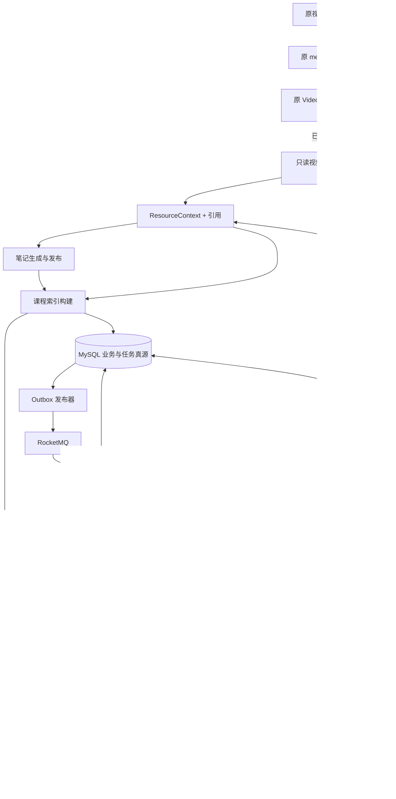

# 课程学习工作台：技术设计

> **历史技术参考：** 当前一期以 [课程工作台 v2 工程规范](course-workbench-v2.md) 为准。本文的入口、独立资料产品结构、接口及任务规划不能直接作为现行契约；一期不以 RAG/索引发布/复习功能为前置。

> 版本：兼容性复核版 v1.1 · 日期：2026-10-12  
> 状态：设计复核完成，作为增量开发基线；尚未实现或压测。参数和质量阈值须由 P0 样本验证。  
> 产品范围与交付顺序见：[开发文档](course-learning-development.md)。

> 本方案已拆成 [38 个 AI 开发任务包](learning-plan/TASKS.md)，共享契约、测试门禁与交接规则见 [执行入口](learning-plan/README.md)。任务包不改变本文的兼容性边界。

## 1. 设计结论与现有代码边界

保留 Java 21 / Spring Boot 单体，复用 MySQL、Redis、RocketMQ、MinIO、Qdrant、LangChain4j 和 Vue。在原视频模块之外新增独立资料、笔记、课程领域；课程归档可选，文档不建课也能提炼知识和保存笔记。视频通过适配器接入新增领域，原有处理链路和结果继续使用。文档解析采用 Apache PDFBox + Apache POI，扫描 PDF 复用 Tesseract 的工具能力。课程 Agent 采用单 Agent、受控工具调用和显式状态机，与原 Video Agent 并存。

课程专家通过 RAG 使用当前课程的原文和发布笔记，不为每个课程启动一个服务，也不进行逐课程微调。

已检查的代码及扩展点：

| 当前实现 | 实际约束 | 扩展方案 |
|---|---|---|
| `MediaFile`、`MediaController` | 模型和接口面向视频 | 新建独立资料表，通过 `legacy_media_id` 懒关联；课程成员关系另表保存 |
| `VideoContext` | 证据定位为时间区间 | 增加 `ResourceContext` 和通用 `SourceLocator`，提供视频适配器 |
| `VideoChunkingService` | 约五分钟视频分块 | 文档采用结构分块，课程检索采用统一文本块 |
| `QdrantVectorStore` | payload 主要是 `mediaId`、起止时间 | 新增课程 collection 和存储类，强制用户、课程、版本过滤 |
| `AgentPlan.tasks` | 字符串任务清单 | 新建 `CourseAgentState`；不改变旧 DTO 或旧检查点的序列化 |
| `AiService.followUp` | 检索后再运行完整分析循环 | 课程问答区分简单问答与复杂规划路径 |
| `AgentCheckpointRepository` | MySQL 真源 + Redis 缓存 | 新任务独立建模，沿用事务提交后更新缓存原则 |
| `TaskEventService` | 事件键绑定视频、目标、模式 | 新任务按 `jobId` 发事件，不混用旧键 |
| `WebConfig` | 拦截 `/media/**`、`/analysis/**` 等；CORS 未放行 PATCH | 新 `/api/v1/**` 全部受保护，显式补充 PATCH / PUT |

第一版不引入 Elasticsearch、独立 Python Web 服务或多 Agent 框架。中文词法召回使用现有 MySQL 的 ngram 全文索引；只有评估表明召回或吞吐不够时再升级。

### 1.1 兼容契约与允许变更

| 边界 | 必须保持 | 允许新增 |
|---|---|---|
| 旧 API | `/media/**`、`/analysis/**`、`/user/**`、`/admin/**` 的请求、响应、状态码、默认模式 | 独立 `/api/v1/**` API；旧接口不新增必填 courseId |
| 旧数据 | `media_files`、历史结果/追问/反馈/检查点可读；不改旧主键 | 新表、懒关联和读取适配；不批量搬迁旧视频 |
| 分析行为 | GENERAL / LEARNING / REVIEW / CREATION / AUTO 原语义、提示词、默认预算 | 独立笔记生成和课程 Agent 提示词/预算 |
| 异步设施 | 旧 MQ topic/group、消息体、Redis 键、SSE 事件、锁和失败队列 | 新 topic/group、`learning:` 命名空间和 jobId 事件 |
| 向量库 | 旧 `video_chunks` collection 和查询过滤行为 | 新课程 collection；不重建或清空旧 collection |
| 文件与设置 | 旧对象路径、上传大小、账号会话、时间与 ID 返回格式 | 新资料对象前缀、新 DTO 的字符串 ID 和 UTC 约定 |
| 页面与扩展 | 原根路径、`?demo`、时间戳链接和扩展请求继续有效 | 新页面和显式“加入课程”“保存笔记”按钮 |

允许修改的共享接入面限定为：增加新路由/鉴权路径、CORS 方法、注册新模块、增加旧结果只读适配和新按钮。共享工具若必须抽取逻辑，先对旧调用建立契约测试，再做保持行为的重构。禁止顺手升级旧 AI 模型、改写旧 AgentLoop、全局变更 JSON 序列化或重命名旧 Redis 键。

后端新模块以 `learning.enabled=false` 为默认开关，关闭时新消费者、发布器、扫描器、模型调用和新路由业务不可执行；旧服务保持可用。前端开关只控制新入口。新增凭证或配置缺失不得导致关闭状态下的原应用启动失败。

## 2. 架构与部署



单节点起步时 API 和新增 Worker 由同一 Spring Boot 工程运行。新增 `learningTaskExecutor / learningModelExecutor / learningParseExecutor` 有界线程池，不使用旧视频线程池或复用旧消费组。PDF/Office 解析在独立受限 Java 子进程中执行，避免解析器失控拖垮 API JVM；使用环境变量白名单，子进程无数据库或模型凭证。Linux 部署加进程/容器资源限制；Windows 开发使用相同命令入口、进程树超时终止和 JVM 堆上限。

共享机器和外部 AI 配额仍会产生资源竞争，不能仅凭分线程池承诺零延迟影响。新任务采用独立并发、用户额度及待执行上限，资源不足时只暂停/拒绝新学习任务；不抢占旧视频执行器。混合负载验收不达标时，先降低新增并发，再将学习 Worker 拆到独立进程/容器。模型账户硬配额不足时使用独立学习凭证或降低新任务额度，不改旧限流参数。

需要扩容时，同一产物通过 `api` / `worker` profile 分开部署，依靠 MySQL 任务租约和 MQ 消费协调。首版 Compose 仍主要负责中间件；新增应用部署配置需在实际部署阶段编写，不把当前 Compose 误认为已包含应用。

解析子进程交付为独立 `learning-parser` Java CLI jar，放在新增目录并单独打包，不要求改成多模块重构原 `server/pom.xml`。协议为输入文件路径 + 受限配置 JSON → 输出 `ResourceContext` JSON/图片产物 + 明确退出码。使用 `ProcessBuilder` 参数列表执行，限制输入输出在任务临时目录，禁用 shell 拼接。缺失 jar 或 OCR 命令只让对应学习任务明确失败，关闭学习功能时不加载相关组件。

## 3. 数据模型

新增用户内容查询均使用登录态得到的 `owner_id`，不接受客户端指定所有者。仅新增 DTO 的 `id` 对外作为字符串序列化，新增时间字段按 UTC 存储和明确偏移量输出；不改全局 ObjectMapper、JVM/数据库时区或旧字段语义。读取旧视频时间按原约定转换显示，避免历史数据时间漂移。

下列字段是实现契约的核心，实际迁移需补齐审计字段、外键或等效事务约束。普通业务表统一包含 `created_at / updated_at / deleted_at / row_version`，不可变版本表只保留创建信息。

### 3.1 课程与资料（P1～P2）

| 表 | 核心字段 | 约束与索引 |
|---|---|---|
| `courses` | id, owner_id, title, term, description, status, active_kb_generation | 索引 `(owner_id, status, updated_at)` |
| `course_chapters` | id, course_id, title, sort_order | 索引 `(course_id, sort_order)`；资料章节必须属于本课程 |
| `learning_resources` | id, owner_id, type, title, legacy_media_id, active_revision_id, status | 独立资料，无 courseId；`legacy_media_id` 唯一可空；索引 `(owner_id, type, status)` |
| `course_resources` | id, owner_id, course_id, resource_id, chapter_id, role, membership_version | `role=LECTURE/HANDOUT/SYLLABUS/EXAM_SCOPE/OTHER`；`resource_id` 唯一，首版至多一个课程；索引 `(owner_id, course_id)` |
| `resource_revisions` | id, resource_id, version_no, object_key, hash_algorithm, content_hash, mime_type, size_bytes, parser_version, extraction_status, context_object_key, quality_json | 唯一 `(resource_id, version_no)`；同用户内容哈希检查作为应用去重，不建立跨用户共享 |
| `source_chunks` | id, owner_id, resource_revision_id, ordinal, title_path, text, locator_json, content_hash, quality_state | 不绑定课程；唯一 `(resource_revision_id, ordinal)`；索引 `(owner_id, resource_revision_id)`；课程全文索引只放 `knowledge_chunks` |

`learning_resources` 是稳定资料身份，`course_resources` 仅保存当前归档关系，例外地采用删除关联行而非软删除；历史关系记录在 job/run manifest 中。移出课程删除关联，不删除资料、版本、源块和单资料笔记；再次关联校验同一 owner，并创建新的 membership_version。移动课程采用事务解除旧关系并建立新关系，两门课分别重建索引；检索按当前归属立即隔离。

视频保留 `media_files` 为原业务真源，仅在加入课程、首次生成新笔记或显式准备资料时幂等创建 `learning_resources` 记录；无须迁移全量视频。新资料库列表由后端聚合旧视频与文档，旧视频用 `(kind=VIDEO, mediaId)` 标识，已有映射去重，不依赖后台复制完成才能显示。排序采用稳定的 `(createdAt, kind, sourceId)` 游标，不把两个列表分别分页后简单拼接。

只读适配器把已有完整 `VideoContext` 复制成独立 `ResourceContext` revision；若仅有纯转写，明确标记 ASR-only，按用户请求再补 OCR。确无可用提取结果时，启动新 learning 提取任务：可复用底层 ASR/OCR 工具代码，但不写旧摘要、旧状态、旧分析检查点。原任务正在处理时，新任务等待或使用现有结果；超过等待上限提示重试，不主动重复启动同份视频的提取。

新任务不能阻止旧流程随后启动；若旧流程与新提取出现竞争，新任务在阶段边界检测旧处理中状态后暂停或取消自己的提取。无法彻底消除的极短竞态计入成本监测，不为保证跨链路去重改写旧消费者。P0 验证适配器是否可独立使用，抽取公共工具前必须测试旧调用行为。

旧视频仍使用原哈希逻辑；新增文档采用 SHA-256。新版本明确记录 hash_algorithm，不能把旧 MD5 误标为 SHA-256。源块和 locator 在 revision 内不可变，重新提取产生新版本。

### 3.2 笔记与知识库（P3）

| 表 | 核心字段 | 约束与索引 |
|---|---|---|
| `study_notes` | id, owner_id, resource_id, course_id, chapter_id, title, scope, published_revision_id, status | RESOURCE 必须有 resource_id、course_id 为空；CHAPTER/COURSE 必须有 course_id；索引 `(owner_id, resource_id, status)` 与 `(course_id, status)` |
| `note_revisions` | id, note_id, version_no, markdown, sections_json, source_manifest_json, goal, validation_json, origin, created_by | 唯一 `(note_id, version_no)`；origin=GENERATED/USER_EDITED |
| `note_source_refs` | note_revision_id, section_id, source_chunk_id, source_revision_id, quote_hash, validation_state | 显式反向引用；索引 `(source_revision_id, note_revision_id)`，支持失效通知 |
| `knowledge_chunks` | id, owner_id, course_id, kb_generation, layer, source_chunk_id, note_revision_id, text, embedding_key, content_hash, citation_json | layer=SOURCE/NOTE；确定性 UUID 主键；全文索引 `text WITH PARSER ngram`，过滤索引 `(owner_id, course_id, kb_generation, layer)` |
| `kb_generations` | id, course_id, generation_no, state, manifest_json, pipeline_version, expected_points, indexed_points | 唯一 `(course_id, generation_no)`；state=BUILDING/READY/FAILED/RETIRED |

单资料笔记属于个人资料库，不因移出或删除课程而删除；课程通过资料的当前成员关系选入该资料的已发布笔记。章节/整课笔记属于课程，随课程删除。生成单资料笔记首版只绑定一份资料；跨资料笔记必须明确课程范围，防止把别课来源带入当前课程。

自动生成的 revision 另带 `source_job_id + artifact_key` 唯一约束；重投恢复查找同一产物而非分配新版本号。资源提取版本、题目和计划也使用同样的作业产物唯一键，避免“幂等消费但重复落库”。手工编辑不带 jobId，通过客户端 Idempotency-Key 和 expectedVersion 防重复/覆盖。

知识块主键建议使用确定性 UUID：`courseId + generation + layer + originId + ordinal`，重复 upsert 覆盖同一点；哈希相同但来源不同的块保留各自来源。

Embedding 缓存按 `ownerId + modelId + dimension + contentHash` 命中；缓存向量可放 MinIO，元数据由知识块指向。缓存不是业务真源，可重建。

### 3.3 异步任务和对话（P2～P4）

| 表 | 核心字段 | 约束与索引 |
|---|---|---|
| `learning_jobs` | id, owner_id, resource_id, course_id, type, idempotency_key, status, stage, progress, input_manifest_json, checkpoint_json, attempt, lease_until, lease_token, cancel_requested, error_code, result_ref | 独立资料任务 course_id 可空；唯一 `(owner_id, type, idempotency_key)`；索引 `(status, lease_until)` |
| `learning_outbox` | id, event_type, aggregate_id, payload, status, next_attempt_at, attempts | 索引 `(status, next_attempt_at)`；成功发送后更新状态，允许重复发送 |
| `course_conversations` | id, owner_id, course_id, title, summary_json | 索引 `(owner_id, course_id, updated_at)` |
| `course_messages` | id, conversation_id, role, content_json, citations_json, kb_generation, run_id | 引用及结果版本固定；未完成消息不进入事实记忆 |
| `agent_runs` | id, job_id, conversation_id, kb_generation, state_json, prompt_version, tool_version, model_config_hash, token_usage_json, stop_reason | 一个 run 对应显式目标和知识库快照；状态可恢复 |

工具调用记录作为 `agent_runs.state_json` 中的受限历史，较大输入输出放 MinIO，数据库存摘要和对象引用；后续量增再独立 `agent_steps` 表。不得持久化或展示模型隐藏推理，只记录任务、工具输入输出摘要、证据和决策结果。

### 3.4 复习（P5）

| 表 | 核心字段 | 约束与索引 |
|---|---|---|
| `course_topics` | id, course_id, chapter_id, name, aliases_json, source_refs_json, importance, importance_origin, confirmed, status | 稳定 topicId；改名不改变掌握度归属 |
| `review_profiles` | id, owner_id, course_id, exam_at, timezone, minutes_per_day, scope_json, version | 唯一 `(owner_id, course_id)`；范围含确认的 topicIds |
| `review_plans` | id, owner_id, course_id, version, profile_version, kb_generation, tasks_json, status | 不可变计划版本；状态 DRAFT/APPLIED/SUPERSEDED |
| `practice_questions` | id, owner_id, course_id, topic_ids_json, type, prompt, options_json, answer_json, rationale, source_refs_json, validation_state | 仅校验通过且来源有效的题可自动评分 |
| `practice_attempts` | id, owner_id, question_id, client_attempt_id, submitted_answer, score, grading_method, created_at | 唯一 `(owner_id, client_attempt_id)`，防重复计分 |
| `topic_mastery` | owner_id, topic_id, evidence_count, weighted_score, last_practiced_at, next_review_at, version | 主键 `(owner_id, topic_id)`，由有效答题记录可重算 |
| `review_task_progress` | owner_id, plan_id, task_id, status, completed_at, actual_minutes | 唯一 `(owner_id, plan_id, task_id)`；计划内容不变，执行状态单独保存 |

这些表按阶段迁移，不要求 P1 一次性创建。MVP 以 JSON 保存笔记段落、计划任务等整体读写内容；权限、版本、状态和反向引用必须使用明确字段，不藏在不可查询的大 JSON 中。

## 4. 文档解析与统一上下文

### 4.1 解析器选择

| 类型 | 组件与实现 | 来源定位 |
|---|---|---|
| PDF | PDFBox 3.x：按页提取；文本质量低的页面渲染后交给 Tesseract | page，从 1 开始；可选 boundingBox |
| DOCX | POI XWPF：按正文元素顺序读取段落、表格，提取样式标题 | headingPath + paragraphIndex / tableIndex |
| DOC | POI HWPF：基础文字和段落；能力降级标记 | paragraphIndex，不给页码 |
| PPTX | POI XSLF：按 slide、shape、表格、备注遍历 | slide 从 1 开始，shapeId 可选 |
| PPT | POI HSLF：按页提取文本 | slide |
| 视频 | 现有 ASR/OCR → 适配器 | startMs / endMs |

PDFBox 3 的加载入口应使用 `Loader`；优先文件输入以避免将完整文件复制进内存。Office 格式对应关系依据 [POI 组件说明](https://poi.apache.org/components/index.html)，PDF 加载行为依据 [PDFBox 3 迁移指南](https://pdfbox.apache.org/3.0/migration.html)。依赖精确补丁版本在 P0 做兼容和依赖安全检查后锁入 Maven，不使用动态版本。

首版不使用通用抽取器输出一整段纯文本，因为需要保留页码、幻灯片和段落定位。暂不引入 LibreOffice 服务；Word/PPT 提供提取内容预览与原文件下载，PDF 可通过 PDF.js 定位页码。PDF.js 精确版本同样在 P0 锁定。

### 4.2 接口契约

```java
interface ResourceParser {
    boolean supports(DetectedFileType type);
    ParseResult parse(ParseInput input, ParseLimits limits);
}

record SourceLocator(
    String kind,           // VIDEO / PDF / WORD / SLIDE
    Long startMs, Long endMs,
    Integer page, Integer slide,
    String headingPath, Integer paragraphIndex,
    String blockId
) {}

record ResourceBlock(
    String blockId, String text, SourceLocator locator,
    String extractionMethod, String qualityState
) {}

record ResourceContext(
    String resourceId, String revisionId,
    List<ResourceBlock> blocks, List<String> warnings
) {}
```

生成后的笔记定位使用独立 `NoteLocator(noteId, revisionId, sectionId)`；每个可检索笔记块还须关联原始 `SourceLocator`。locator 是受服务端校验的定位信息，不允许模型任意生成对象 URL。

### 4.3 分块与质量

先按标题、段落、页和表格边界分块，再应用 token 上限。初始目标每块约 500～800 token，必要时相邻重叠约 80 token；具体 tokenizer 与模型上下文限制匹配，缺失时使用保守字符估计并保留余量。跨页块保留多个 locator，不能只记录第一页。

长表格重复表头后分段；公式和图表无法可靠提取时保存源位置、标记 `NEEDS_REVIEW`。扫描 PDF 按页判断有效文本量和乱码比例，只对需要的页面 OCR；阈值通过真实样本校准。

`READY` 表示有可用文本；`PARTIAL` 表示部分页面失败但明确列出；`FAILED` 表示无可用内容或处理不安全。源文缺损不允许以“模型补全”伪造。

### 4.4 资源限制（拟定初始值）

| 项目 | 初始限制 |
|---|---|
| 单文档大小 | 50 MiB；仅文档端点校验；网关按路径限制，Spring 全局 multipart 保持足够容纳原视频请求，不下调旧视频上限 |
| PDF 页数 / PPT 页数 | 300 / 300 |
| DOCX 段落数 | 20,000 |
| 单文件 OCR 页数 | 100；更多页面返回明确限制，允许后续拆分 |
| Office 解压总量 | 300 MiB，并限制条目数、单条目大小和压缩比 |
| 解析子进程 | 堆上限 512 MiB；普通提取 120 秒；OCR 每页 20 秒、整任务 15 分钟 |
| 首版解析并发 | 2，OCR 并发 1；独立队列及线程池，结合原视频负载进行准入限制 |
| 单课程 | 100 份资料、每个 generation 合计 10,000 个 SOURCE/NOTE 知识块；超限提前提示 |

文件头、扩展名和 MIME 联合检查；拒绝加密文件并告知用户解密后重传。禁用外部实体/外部资源加载，不执行宏或嵌入内容。超时必须终止并回收子进程与临时文件，不能只取消 Future。JVM 堆限制之外仍需部署层约束进程总内存，实际总资源预算在 P0 测量。

## 5. 异步任务、一致性与恢复

### 5.1 状态机

```text
QUEUED → RUNNING → SUCCEEDED
             ├──→ PARTIAL
             ├──→ WAITING_DEPENDENCY → QUEUED
             ├──→ RETRY_WAIT → RUNNING
             ├──→ FAILED
             └──→ CANCELLED
```

阶段独立于状态：`VALIDATING / EXTRACTING / OCR / CHUNKING / NOTE_GENERATING / INDEXING / VERIFYING`。进度无可靠总量时展示阶段和已完成页数，不伪造精确百分比。

等待原视频提取等依赖时保存 WAITING_DEPENDENCY 并释放执行线程和租约，由扫描器检查依赖及截止时间后唤醒。被较新任务替代使用 CANCELLED + stopReason=SUPERSEDED，不额外制造未定义的终态。PARTIAL 为终态，必须返回成功部分和未处理清单，不能对用户宣称全量完成。

### 5.2 投递和幂等

业务写入、`learning_jobs` 和 `learning_outbox` 在同一 MySQL 事务提交；定时发布器投递 MQ 后标记已发送。MQ 消息只携带 jobId 和协议版本，Worker 重新读取数据库输入，避免消息携带过期权限或全文。

新主题使用 `learning-jobs-v1`，消费组、失败主题、Redis 通道和限流键独立命名；不把文档任务塞进旧 `AnalysisTaskMsg`。文档原文件上传 MinIO 与数据库无法组成单事务：先写暂存对象，数据库提交后转为有效引用；数据库失败则尽力删除，定期扫描超过 24 小时且无数据库引用的暂存对象。删除须二次确认无引用，不能按前缀整批误删。

消费采用至少一次语义。幂等键包括用户、操作、资料/笔记版本、归一化需求摘要和流水线版本。主动重新生成使用新的 run nonce；网络重复提交沿用相同客户端 Idempotency-Key。

Worker 使用带过期时间的数据库租约和递增 `lease_token` 领取任务；心跳续租。写入检查点、状态和最终产物必须携带当前 token 做条件更新，防止过期 Worker 覆盖新结果。超时租约由恢复扫描器重新入队，不能仅依赖 MQ 重投。

外部临时故障最多 3 次任务级尝试，指数退避并加抖动；格式不支持、密码保护、越权、超限等永久错误直接终止。重试从已成功检查点继续，不重新跑整套视频提取。

### 5.3 SSE

事件包含 `jobId / sequence / state / stage / completedUnits / totalUnits / errorCode`。MySQL 保存最新状态和递增版本，Redis Pub/Sub 只用于通知。重连时先建立订阅，再补拉最新状态，以 sequence 丢弃旧消息；客户端发现断流可回退轮询。

首版不承诺逐事件历史重放，只承诺重连后取得最新真实状态。SSE、轮询、取消接口都校验 job 所有者。课程 Agent run 也映射为 job，统一取消和预算行为。

## 6. 笔记生成、发布与失效

### 6.1 生成流程

选择资料清单并固定 revision → 逐资料/章节提取候选知识 → 按标题合并去重 → 生成结构化段落和 Markdown → 校验引用 → 保存不可变草稿。

单资料使用原始块；整课任务枚举指定范围所有可用资料，逐章汇总，不用问答 TopK 代替全量覆盖。检查点保存每个资料的提取结果，任一步失败可显示覆盖率和缺失列表。

每个笔记段落至少包含：`sectionId / title / content / topicIds / citations / validationState`。引用由模型选择服务端提供的 chunkId，再由服务器补齐资源名、版本和 locator。模型不能自行构造页码或引用未提供的 chunk。

单资料任务以 resourceId 为范围，不需要 courseId；独立资料全量提炼采用分块归纳，直接读取 owner 授权的源块，不要求先创建课程向量库。用户自定义提炼要求受长度和内容窗口约束，不能通过提示词更改来源范围。

“保存原视频结果为笔记”输入 mediaId、原 goal、mode 和原结果版本/摘要：只读已有结构化结果，创建新的 RESOURCE 笔记草稿。时间戳和引用能映射到源块才标为待验证证据；缺少来源的历史结果保存为 `NEEDS_REVIEW`。只有用户另行选择补充证据时才调度新任务，禁止把保存操作变成原视频重新分析。

### 6.2 发布规则

自动保存草稿；用户发起发布。可检索段落须具备有效来源引用，且语义支持验证明确为 `SUPPORTED`；未验证、验证服务失败、`CONTRADICTED`、`INSUFFICIENT` 均不可当可靠证据。纯个人补充可留在笔记中，但以 `USER_NOTE` 标记，首版不进入可靠证据索引。

编辑已有内容会使相关段落的验证状态失效，必须重新校验后发布；不得沿用旧版“已验证”标记。首版允许部分段落发布，但必须显示纳入/排除列表，零可用段落则发布失败。未归课 RESOURCE 笔记通过验证后更新发布指针，状态显示“已发布，未归课”；加入课程时再建索引。已归课资料笔记和课程笔记发布时构建新 generation，成功后事务切换笔记发布指针和课程知识库指针，失败则上一发布版继续可用。

Markdown 编辑不直接覆盖引用 JSON：服务端按显式 sectionId 和引用标记解析，内容变化使该段验证失效；删除引用视为无来源内容。首版未知或损坏标记作为普通文本保存并告警，不推测引用关联。

### 6.3 原文变化

来源删除立即阻断使用；来源新版本正式启用时，通过 `note_source_refs` 标记依赖笔记为 `STALE`。相关段落停止作为新答案证据，提示用户重新生成或校验。仅移出课程时，独立单资料笔记保持有效，该课程的知识库资格失效；引用它的章节/整课笔记段落标为待更新。首版以段落为失效粒度，暂不自动改写用户笔记。

旧笔记、旧答案保存历史文本和引用标识；访问源内容时仍按当前权限检查。历史快照不能绕过删除或权限撤销。

## 7. 课程 RAG 设计

### 7.1 双层知识库

- `NOTE` 层：已发布且来源有效的学习笔记，便于概念解释和复习。
- `SOURCE` 层：原视频转写、OCR、文档原文，用于核验、补细节和查冲突。

没有发布笔记时可使用 SOURCE 层，界面明确提示；发布后问答优先查找相关笔记并回查原文，trace 记录实际命中的 noteRevisionId。新增“使用笔记”验收样例必须证明编辑后发布的新笔记被检索，不能只把笔记存下来却始终绕过它。

同一个 chunk 的摘要不能作为多个独立证据投票。笔记与其原文在融合时识别共同来源并去重；涉及数值、定义、日期或冲突判断时必须回查原始块。

### 7.2 检索路径

1. 服务端根据登录态校验 courseId，固定 `ownerId + courseId + kbGeneration`。
2. 根据近期对话把“它、上一章”等指代改写为检索问题；改写不得引入新的事实。
3. 在 NOTE / SOURCE 层分别进行 Qdrant 向量召回与 MySQL ngram 词法召回。
4. 初始每路取 20 条候选，使用 RRF 合并：`score = Σ 1 / (60 + rank)`；来源去重后选取 6～10 块。
5. 对候选回查 MySQL 的所有者、当前 course_resources 成员关系、版本、删除状态和引用有效性；关联旧视频还必须检查原 media_files 记录存在且 owner 匹配。无效项丢弃并在预算内补召回。
6. 必要时读取相邻块，形成受 token 上限约束的证据包。
7. 生成结构化答案，校验引用存在性与关键结论语义支持。

MySQL ngram 全文解析支持中日韩文本，具体行为见 [MySQL 官方文档](https://dev.mysql.com/doc/refman/8.0/en/fulltext-search-ngram.html)。部署时固定 `ngram_token_size` 并记录于索引版本；调整它需要重建全文索引。词法和向量分数不可直接相加，因此采用排名融合。首版不新增远程 reranker 依赖，评估不足时再接入。

整体总结走章节覆盖流程；事实问答走局部检索；对比问题拆成多个子查询；审查问题额外检索反证。检索策略属于明确的任务类型，不由模型随意越过课程边界。

### 7.3 Qdrant 与版本切换

新 collection 示例 `course_knowledge_bge_m3_v1`，与原 `video_chunks` 分离。实际名称包含 embedding 模型/维度版本；禁止在同一 collection 混用不兼容向量。

payload：`ownerId / courseId / kbGeneration / layer / resourceRevisionId / noteRevisionId / chunkId`。对主要过滤字段创建 payload 索引，每次检索必须使用 `must` 过滤。Qdrant 支持带 payload 条件的检索，见 [过滤文档](https://qdrant.tech/documentation/search/filtering/)；过滤本身不替代应用权限校验。

首版在课程规模上限内采用“课程快照构建、指针切换”：

1. 每门课串行构建 generation N+1；新增变更在构建中合并到后续任务，避免每个上传都重建一次。
2. 固定源版本和待发布笔记清单；复用未变化内容的 embedding，不重新调用模型。
3. MySQL 写入新 generation 的知识块，Qdrant 幂等 upsert 并等待完成，核对预期 ID 和数量。
4. 成功后事务更新 `active_kb_generation` 和关联发布指针；生成过程中旧 generation 持续可用。
5. 失败保持旧指针，标记新 generation 失败并可重试；首次构建失败则知识库不可用。

笔记发布、资料版本启用和成员关系变更由同一个课程级构建队列串行处理。提交指针前检查输入版本、membership_version 和课程 `row_version`；构建期间发生删除、取消或更新使清单失效时，不得发布旧清单，任务应重建或标为被新任务替代。成员加入即使索引失败也保留归档关系，页面显示“尚未纳入知识库”。

该方案会重复保存不同快照的向量，是换取清晰一致性的首版取舍。保留最近两代和运行中任务引用的代，后台回收其他代；超出首版规模后再改成按资料增量版本清单。

每个 Agent run 固定 generation；删除和权限撤销仍以最新 MySQL 状态为准。在检索后和答案提交前重新校验来源，已删除证据不能因为旧快照继续输出。embedding 或 Qdrant 故障时使用 MySQL 词法召回并显示降级状态，后台补建向量；两路都无法获得证据时停止事实回答。

## 8. 课程 Agent

### 8.1 状态和工具

```text
UNDERSTAND → RETRIEVE → ANSWER → VERIFY → DONE
                ↑                  │
                └── 补证据/修订 ────┘
终止：INSUFFICIENT_EVIDENCE / BUDGET_EXHAUSTED / CANCELLED / FAILED
```

复杂任务先生成结构化计划：`taskId / objective / dependsOn / tool / arguments / acceptanceCriteria / status / evidenceIds`。简单问答跳过规划调用。每次工具观察保存到 run 状态；修订必须带上上一版草稿、具体问题 ID 和已通过的内容，避免整篇无依据重写。

| 工具 | 输入 | 行为 |
|---|---|---|
| `searchCourseKnowledge` | query, topicIds, sourceTypes | 检索本课程已授权知识 |
| `getSourceExcerpt` | chunkIds | 读取原始块和相邻上下文 |
| `getCourseOutline` | 无或 chapterId | 获取章节与已确认知识点 |
| `getLearningProfile` | 无 | 读取当前用户本课程的范围和掌握记录 |
| `draftPractice` | topicIds, count, difficulty | 生成待校验题目草稿 |
| `draftReviewPlan` | profileVersion | 生成待应用的计划草稿 |

工具注册表按名称分发，使用 JSON Schema 校验参数；用户和课程从服务端 run 上下文注入，模型不能改写。只读工具可自主执行，发布笔记、应用计划和提交答题由明确用户操作调用业务 API。

### 8.2 答案契约

```json
{
  "answer": "解释内容",
  "claims": [
    {"id": "c1", "text": "关键结论", "citationIds": ["ref1"], "status": "SUPPORTED"}
  ],
  "citations": [{"id": "ref1", "chunkId": "..."}],
  "uncertainties": [],
  "coverage": {"usedResources": 3, "availableResources": 12},
  "stopReason": "COMPLETED"
}
```

`SUPPORTED` 是当前证据校验结果，不是真实世界正确性的保证。引用定位由服务端补全，验证失败的结论删除、修订或明确标为证据不足；不能仅凭格式完整显示成功。`usedResources` 表示用到多少资料，不代表对整门课进行了完整覆盖。

### 8.3 预算与记忆

拟定每次问答最多 6 次工具调用、8 次模型调用（含重试）、2 次修订、120 秒执行预算；排队时长单独统计。单工具输出上限 6,000 字符，总证据包按模型 token 窗口限制。相同工具参数连续重复且无新证据时终止补查。

单次长笔记任务采用单独预算和子任务检查点，不受问答 120 秒限制。每个外部调用前检查剩余时间与额度，超预算后不再启动新调用。实际 token 用量优先取服务端 usage，缺失时估算并标明；用户日额度和价格由配置控制，金额估算不能视为账单。

对话保留最近若干轮和带来源的简短摘要；历史回答仅作为语境，不作为课程原始证据。学生掌握度只来源于有效练习记录和明确自评，模型不得自己“记住”一个未经验证的分数。

资料、OCR 和检索内容作为不可信数据放入证据区，不能覆盖系统政策或调用任意工具。加入包含“忽略指令”等文本的资料作为测试样例；工具权限校验负责实际边界，提示词只作辅助。

## 9. 复习闭环

### 9.1 知识点与范围

从大纲和已发布笔记生成候选知识点，保留来源；按名称和别名给出合并建议，用户确认后形成稳定 topicId。考试范围导入作为 `EXAM_SCOPE` 资料提取候选 topicIds，由用户确认包含/排除及重要性。模型推测权重与用户确认权重分别标记。

### 9.2 掌握度与排序

首版采用可解释规则，不宣称心理测量意义上的能力估计：

- 每个知识点收集最近 5 次有效客观题结果，按最近程度加权平均得到练习表现分。
- 同一题短期重复提交只作为复练，不重复增加独立样本量；重复网络请求由唯一键去重。
- 少于 3 道不同题时显示“样本不足”；零样本显示“未知”，不能记作 0 分。
- 简答题自评单独保存，首版不混入客观题分数。

已知知识点的初始排序：`priority = 0.5 × confirmedImportance + 0.3 × weakness + 0.2 × overdue`，各项归一化到 0～1。未知项进入诊断队列并预留复习时间。该公式是工程起点，须通过使用反馈校准，不代表考试预测。

### 9.3 计划和练习

服务端规则先保证每日任务时长不超过用户预算，模型负责解释、举例和组合学习材料。任务类型为 `READ_NOTE / REWATCH / PRACTICE / REVIEW_ERRORS`，每项绑定 topicId、引用、预计分钟数和安排原因。

知识点太多时保留未排入清单并提示时间不足，不虚构全部完成。考试日期已过、每日时间为零等输入直接校验。日期排程按用户时区计算，UTC 存储。

题目生成后检查答案唯一性、题干可理解性、来源支持和选项格式；失败题不投放。答案及解析在服务端保存，作答前的接口不返回答案字段。题目来源失效后停止投放，历史作答保留但不作为新版课程的确定性依据。

提交答案 → 幂等保存 attempt → 更新 topic mastery → 标记计划可优化 → 用户选择应用新计划版本。阅读和回看任务通过显式“完成/跳过”更新 `review_task_progress`，不把播放或浏览行为直接等同于掌握。应用新计划时已完成记录保留在旧版本，不被覆盖。首版复习提醒显示在站内，不增加短信、邮件或定时推送依赖。

## 10. API 草案

新增 API 统一前缀 `/api/v1`；沿用 `Result<T>` 响应结构，旧 API 完全保留。PATCH 等方法仅扩展 CORS，不改变原允许方法。分页默认 20、最大 100。写接口支持幂等键，编辑资源使用 `expectedVersion` 乐观锁，冲突返回 409。

新入口遇到视频仍调用旧 `/media` 上传或链接导入，再调用新 prepare-video 建立资料映射；如果选择课程，再调用课程关联接口。三步分别幂等，可恢复，不用跨系统事务包装旧上传。文档上传直达新 `/resources`，接受可选 courseId；不归课时照常解析。旧客户端无需发送任何新增字段。

| 方法与路径 | 用途 | 成功返回 |
|---|---|---|
| GET /resources | 汇总旧视频与新增文档，支持未归课过滤 | 200 + cursor page |
| POST /resources | multipart 文档上传；courseId/chapterId 可选 | 202 + resourceId、jobId |
| POST /resources/prepare-video | 根据已拥有 mediaId 幂等建立新资料映射，不默认重跑分析 | 200 + resourceId、状态 |
| GET /resources/{resourceId} | 资料状态与详情 | 200 + resource |
| POST /resources/{resourceId}/extract | 显式提取/补充源上下文 | 202 + jobId |
| POST /resources/{resourceId}/reparse | 文档重新解析为新 revision | 202 + jobId |
| GET /resources/{resourceId}/preview | 原文和质量预览 | 200 + preview |
| GET /resources/{resourceId}/citations/{chunkId} | 独立资料的授权引用定位 | 200 + locator |
| DELETE /resources/{resourceId} | 删除新文档；视频返回指向原删除操作的明确业务提示 | 202 + jobId（文档） |
| POST /resources/{resourceId}/notes/generate | 不建课也可按用户要求生成笔记 | 202 + jobId |
| POST /notes/import-video-analysis | 只读原视频结果并保存草稿，含 mediaId/goal/mode/结果摘要 | 201 + noteId、revisionId |
| GET /notes | 全部本人笔记，可筛选资料或课程 | 200 + page |
| GET /notes/{noteId}/revisions/{revisionId} | 读取版本正文 | 200 + revision |
| GET /notes/{noteId}/revisions | 版本列表 | 200 + page |
| POST /notes/{noteId}/revisions | 保存编辑版；恢复旧版也走此接口 | 201 + revision |
| POST /notes/{noteId}/publish | 校验发布；归课时更新课程索引 | 202 + jobId |
| GET /notes/{noteId}/export | Markdown 导出授权版本 | 文件响应 |
| POST /courses | 创建课程 | 201 + course |
| GET /courses | 分页课程列表 | 200 + page |
| PATCH /courses/{id} | 修改/归档课程 | 200 + course |
| DELETE /courses/{id} | 逻辑删除并排队清理 | 202 + jobId |
| POST /courses/{id}/chapters | 新建章节 | 201 + chapter |
| PATCH /courses/{id}/chapters/{chapterId} | 修改标题/排序 | 200 + chapter |
| POST /courses/{id}/resources | 关联已有 resourceId，含 chapterId、role；幂等归档 | 202 + membership、jobId |
| PATCH /courses/{id}/resources/{resourceId} | 修改章节/角色；课程移动使用显式 move 操作 | 200 + membership |
| POST /resources/{resourceId}/move-course | 原子解除旧归档并加入目标课程，校验双方 owner | 202 + jobIds |
| GET /courses/{id}/resources | 分页列出资料 | 200 + page |
| DELETE /courses/{id}/resources/{resourceId} | 移除课程资料 | 202 + jobId |
| GET /courses/{id}/citations/{chunkId} | 授权后的定位和短时访问地址 | 200 + locator |
| POST /courses/{id}/notes/generate | 提交范围、资料 ID、用户要求 | 202 + jobId |
| GET /courses/{id}/notes | 笔记列表 | 200 + page |
| GET /courses/{id}/knowledge/status | 版本、覆盖范围和索引状态 | 200 + status |
| POST /courses/{id}/conversations | 创建对话 | 201 + conversation |
| GET /courses/{id}/conversations/{conversationId}/messages | 历史消息 | 200 + page |
| POST /courses/{id}/conversations/{conversationId}/messages | 提问 | 202 + runId、jobId |
| GET /jobs/{id} | 最新状态 | 200 + job |
| GET /jobs/{id}/events | SSE 阶段事件 | text/event-stream |
| POST /jobs/{id}/cancel | 请求取消 | 202 + job |
| POST /jobs/{id}/retry | 重试可恢复失败 | 202 + jobId |
| POST /courses/{id}/topics/extract | 从可用大纲/笔记提取候选知识点 | 202 + jobId |
| GET /courses/{id}/topics | 候选/确认知识点 | 200 + page |
| PATCH /courses/{id}/topics/{topicId} | 确认重点、名称、章节 | 200 + topic |
| PUT /courses/{id}/review-profile | 更新考试范围与时间预算 | 200 + profile |
| POST /courses/{id}/review-scope/extract | 从 EXAM_SCOPE 资料提取范围候选，待用户确认 | 202 + jobId |
| POST /courses/{id}/review-plans | 生成计划草稿 | 202 + jobId |
| GET /courses/{id}/review-plans/{planId} | 读取计划 | 200 + plan |
| POST /courses/{id}/review-plans/{planId}/apply | 应用计划 | 200 + plan |
| PATCH /courses/{id}/review-plans/{planId}/tasks/{taskId} | 记录完成/跳过/实际用时 | 200 + progress |
| POST /courses/{id}/practice-sessions | 生成指定知识点练习 | 202 + jobId |
| GET /courses/{id}/questions | 拉取本用户可作答题目 | 200 + page（不含答案） |
| POST /courses/{id}/practice-attempts | 提交答案 | 201 + result、explanation |
| GET /courses/{id}/learning-progress | 掌握记录和错题 | 200 + progress |

全链路检查嵌套 ID 的归属：独立资料/笔记 API 校验 owner 和实际资源关系；课程 API 额外校验当前成员关系、revision、conversation、chunk、question 均属于该课程。不能只验证 courseId 后就按另一个裸 ID 读取对象。课程列表返回归课 RESOURCE 笔记与本课程 CHAPTER/COURSE 笔记，不改变这些笔记的实际所有权。

## 11. 删除、清理与权限

四类操作明确分开：

| 操作 | 同步行为 | 后台清理 |
|---|---|---|
| 移出课程 | 删除成员关系并递增课程版本，立即停止本课检索 | 重建该课索引、标记依赖的课程笔记；保留文件和 RESOURCE 笔记 |
| 删除课程 | 课程 tombstone 并拒绝访问，解除所有归档 | 清理该课索引、CHAPTER/COURSE 笔记、对话、复习；保留个人资料和 RESOURCE 笔记 |
| 删除新文档 | learning_resource tombstone，依赖引用立即不可用 | 清理无引用对象/解析产物/索引；单资料笔记保留历史文本并标来源已删除 |
| 删除旧视频 | 原 `/media/delete` 按现有流程完成 | 新模块巡检清理映射及索引；不让新模块失败阻塞原删除 |

新增逻辑删除和关联变更在事务中写清理 Outbox，后台幂等执行、失败重试。旧视频删除路径不新增同步课程写入，也不创建阻止旧 media 删除的外键。为保证清理延迟不泄漏内容，新资料读取、检索候选、引用跳转和答案最终提交均检查原 `media_files` 当前存在性及 owner；即使学习开关关闭时删除了旧视频，重新开启后也不能检索该视频的旧副本。巡检扫描失效映射并清理残留。清理是最终一致，权限拒绝不依赖它。

后台删除 MinIO 文件前检查对象归属和有效引用；学习清理任务只操作自己的原文档/解析产物前缀，不能删除旧视频桶内对象。新视频依然由原视频删除流程负责。

原文件使用私有对象和短期授权访问，不把长期公开链接写入模型输入。对严格撤销场景采用服务端代理流；短时签名链接在到期前可能继续有效，首版应明确此窗口，并把 TTL 控制在约 60 秒。

课程名、文档文本和笔记不写入普通请求日志；日志保留 IDs、阶段、错误码、时长和用量。授权校验覆盖 API、SSE、导出、引用预览、后台任务启动及提交结果。

## 12. 前端实现

新增 `ResourceLibraryPage / NotesLibraryPage / CourseListPage / CourseWorkspacePage`，课程内包含 `ResourcePanel / NotesPanel / CourseChatPanel / ReviewPanel`。把上传、笔记版本、聊天和复习分别放入 composable，避免继续扩大原 `App.vue`。

先新增轻量入口壳：根路径仍渲染原 App.vue，新增 `/learn` 页面懒加载独立学习模块。Vue Router 只在该模块注册，使用 `/learn` 基路径的 history 路由；部署需增加仅 `/learn/*` 的 SPA fallback，保持 API 和根路径行为。原 `?demo` 及 `#video-t=` 不被新 router 接管。没有新模块权限或功能开关关闭时，新入口隐藏，原 App 不依赖学习接口成功。

新增模块使用命名空间样式，防止全局 CSS 覆盖原工作台；只给旧界面增加受开关控制的导航和明确按钮。首版用 composable 管理状态，暂不强制引入 Pinia。沿用现有 API 包装和鉴权会话失效处理；新引用渲染器包裹现有 Markdown 能力，不改变旧时间戳渲染规则。

资料卡分别展示上传、解析和知识库可用状态。笔记区显示“草稿/已发布/待更新”；聊天区显示引用和证据不足；复习区显示“未知/样本不足/练习表现”，避免伪精确百分比。切换课程时取消旧请求和流，阻止旧响应写入新课程界面。

## 13. 验证与发布

### 13.1 P0 样本与评估

准备至少 12 份经允许使用的真实资料，覆盖文本 PDF、扫描 PDF、DOCX、DOC、PPTX、PPT，各至少两份；另加损坏、超限、加密和图片型文件。准备 3 门相互隔离课程，至少 60 条人工标注问题，覆盖直接问答、跨资料综合、否定条件、冲突、无答案、笔记编辑和来源删除。

数据集分为调试集和固定回归集；标注应包括预期证据位置、允许答案范围和无法回答条件，不能只匹配几个关键词。

拟定上线门槛（待 P0 校准）：

| 指标 | 目标 |
|---|---|
| 权限与课程隔离 | 测试样例零泄漏 |
| 引用存在性及定位正确率 | ≥ 98% |
| 人工判定关键结论有证据支持 | ≥ 90% |
| 无答案题正确表达不足 | ≥ 90% |
| Recall@10（标注证据块） | ≥ 85% |
| 合规格式的基础文本提取成功率 | ≥ 95%，各类型分别报告 |
| 每日计划超预算 | 0 项；不足时间必须显示未排入内容 |

质量指标须附样本量，不以小样本得分冒充普遍准确率。问答完成延迟、首阶段反馈、单任务 token、OCR 时间和模型费用先建立基线，再按部署条件设置 p50 / p95 目标；不承诺外部模型响应的固定秒数。

### 13.2 自动化测试

- 单元：locator 序列化、结构分块、RRF、预算终止、笔记引用失效、复习排程和幂等计分。
- 集成：MySQL 事务与 Outbox、MQ 重投、租约 fencing、Qdrant generation 切换、取消、删除补偿。
- 端到端：课程创建 → 混合资料导入 → 笔记发布 → 引用问答 → 自测 → 应用复习计划。
- 故障注入：解析进程超时、模型 429/超时、Redis 不可用、Qdrant 部分 upsert、Worker 提交前崩溃。
- Agent 行为：无依据问题、矛盾资料、恶意指令文本、工具参数越界、重复检索、历史答案错误传播。

外部模型质量测试与确定性 CI 分开。普通 CI 使用固定响应测试编排和边界；发布前用真实模型运行回归集并保存 model / prompt / tool / pipeline 版本。

### 13.3 原功能兼容回归门禁

P0 先记录当前测试结果、已有失败和旧 API 样例。交付要求是无新增回归；已有失败需记录并单独修复，不能把基线失败误报成新增功能问题，也不能隐瞒。

| 回归组 | 必测场景 | 失败处理 |
|---|---|---|
| 旧账户/API | 注册登录退出、401、越权、旧响应 ID 类型/错误码、默认 GENERAL | 阻止发布 |
| 旧视频入库 | 直接上传、5 MB 分片、断点续传、URL 导入、原大小上限 | 阻止发布；不得用文档限制替代 |
| 旧分析 | 四模式、AUTO、结构化结果、证据跳转、追问和历史、反馈修订 | 阻止发布；新笔记不覆盖原结果 |
| 旧媒体处理 | 转写、转写 SSE、MP3 下载、播放和删除 | 阻止发布 |
| 旧可靠性 | 重复提交、MQ 重投、旧 checkpoint 恢复、失败台账重投 | 阻止发布；保留旧消息与键 |
| 旧客户端 | 现有扩展未修改直接连新版后端；根路径和 `?demo` | 阻止发布 |
| 新增故障隔离 | 解析器缺失/超时、新队列满、课程索引构建失败 | 旧 API 不应出现新增失败或写入旧失败状态 |
| 开关与历史 | 开关关闭启动；关闭时删旧视频后再打开；带旧数据升级 | 禁止检索已删除视频副本；旧功能继续可用 |

现有自动化入口：后端在 `server` 执行 `mvnw.cmd test`（Linux 使用 `./mvnw test`）；前端在 `client` 执行 `npm test`、`npm run build`；扩展在 `extension` 执行 `node --test`。旧浏览器交互、真实模型与混合负载另列端到端验收。本轮只复核文档，未执行这些测试。

混合负载对照：同机同数据集，比较仅旧视频流量与叠加新增解析/问答任务的场景，至少重复三次。记录旧接口受理 p95、旧任务排队/执行时间、错误率、内存和外部 API 限流。以非模型旧接口 p95 增幅不超过 10%、无新增错误为初始门槛；P0 确认测量条件后冻结。外部模型时延独立观察。达不到门槛则降低新并发或独立部署学习 Worker，验收前不能声称无性能影响。

### 13.4 发布与回滚

通过 Flyway 在现有 V1～V3 后新增迁移，实施时重新确认最新版本号，禁止修改已执行迁移。首版主要增加新表，旧表不改字段含义、不新增阻止旧写入/删除的约束。新增依赖使用 Maven dependency tree 检查传递版本冲突，尤其是 JSON、HTTP、日志和压缩库，不能为引入解析器静默替换旧依赖。先备份并在含历史数据的副本上演练，再关闭开关发布，最后小范围开启。

首选回退方式为当前兼容版本关闭入口和新增任务消费，保留表及用户内容；不能通过删表回滚。知识库回退时依据旧 generation manifest 事务恢复一致的发布指针，保留新笔记 revision 并标记待重新发布；当前归属、删除、权限检查仍然生效，不能恢复已删除的知识。

不能直接承诺原旧二进制可在执行新 Flyway 迁移的库上启动：旧应用可能因未知未来 migration 校验失败。需要二进制回退时提供包含新增迁移文件、但禁用学习模块的兼容回退包，并在副本上演练；不临时关闭 Flyway 校验规避。重大 schema 变更采用先兼容读取、再切换写入的两步方式。

## 14. 实现顺序与完成定义

1. P0：建立旧功能/API/性能基线，锁定解析依赖，验证样本和中文检索；明确环境限制。
2. P1：独立资料身份、统一列表、课程/章节关联及权限；旧视频懒关联和原业务回归通过。
3. P2：独立文档导入、ResourceContext、解析 CLI、任务/Outbox/SSE；恢复和超限测试通过。
4. P3：不归课笔记、原视频结果保存、课程笔记、版本发布和 generation 索引；编辑及移除/删除一致性通过。
5. P4：独立课程 Agent、RAG、对话、预算与证据验证；真实笔记命中、问答质量和混合负载验收通过。
6. P5：考试范围、客观练习、掌握记录、计划及执行进度；完整新旧回归和发布/回退演练通过。

阶段工期及用户可见交付物见开发文档。实现前不要求先拆微服务或训练模型；先通过上述闭环验证资料质量、回答可靠性和复习价值，再决定更复杂的技术投入。

## 15. 官方技术依据

以下用于核实组件能力，不表示本项目已集成：

- [Apache PDFBox 3 迁移与加载接口](https://pdfbox.apache.org/3.0/migration.html)
- [Apache POI 组件与 Office 格式映射](https://poi.apache.org/components/index.html)
- [Apache POI Word 组件](https://poi.apache.org/components/document/index.html)
- [Apache POI PowerPoint 组件](https://poi.apache.org/components/slideshow/index.html)
- [Qdrant 条件过滤](https://qdrant.tech/documentation/search/filtering/)
- [Qdrant 多租户设计](https://qdrant.tech/documentation/manage-data/multitenancy/)
- [MySQL 8 ngram 全文解析](https://dev.mysql.com/doc/refman/8.0/en/fulltext-search-ngram.html)

## 16. v1.1 复核记录与范围冻结

| 发现的问题 | 修订后的工程决策 | 验证位置 |
|---|---|---|
| 原方案把导入强绑定课程 | 新增独立 learning_resources，课程仅为成员关系 | §3、§10；无课程导入端到端 |
| 课程删除可能带走个人资料 | 删除课程只清该课知识与记录，保留原文件/单资料笔记 | §11；移出、删除、重新归档测试 |
| 旧视频删除被新增同步写入耦合 | 不改旧删除成功条件，新查询实时校验旧记录，后台巡检 | §11、§13.3 |
| 新上传限制与序列化可能影响旧客户端 | 按新端点/DTO 配置，不改变全局旧约定 | §1.1、§3、§4.4 |
| “保存已有学习结果”缺少接口 | 增加只读导入草稿，不强制重跑旧分析 | §6.1、§10 |
| 复习计划缺少完成记录 | review_task_progress + 完成/跳过 API | §3.4、§9、§10 |
| 新旧任务共享资源可能互相拖累 | 新线程池/队列/额度/开关，混合负载不过则拆 Worker | §2、§13.3 |
| 直接回滚旧二进制可能失败 | 使用带新增 migration 的兼容回退包 | §13.4 |

明确首版能力：PDF/Word/PPT 基础提取、按用户要求生成笔记、版本保存、可选课程归档、笔记驱动的课程 RAG、重点与练习反馈驱动复习。保留全部原视频能力。新增文档不套用视频专属播放、音频导出或视频切片产物；复杂图形公式、多课程共享、外网资料和训练模型不进入本次交付。

目前结论是设计具备分阶段落地路径，关键风险和回归门槛已定义。P0 样本、依赖和资源验证仍是编码阶段的准入项；本记录不等同于功能已实现、压力测试已通过或原系统已验证零回归。
