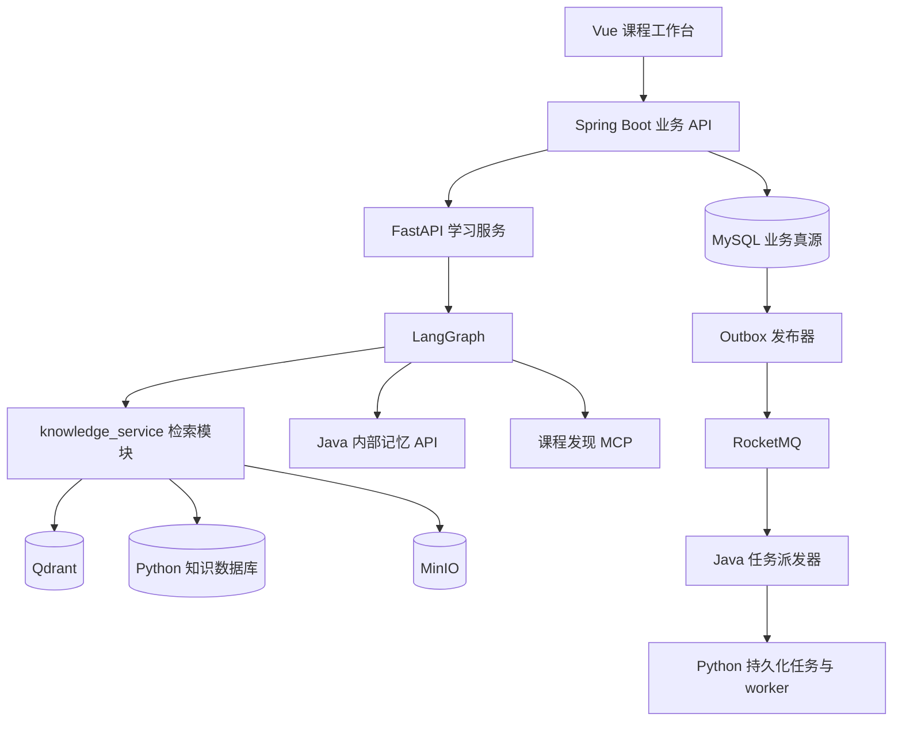
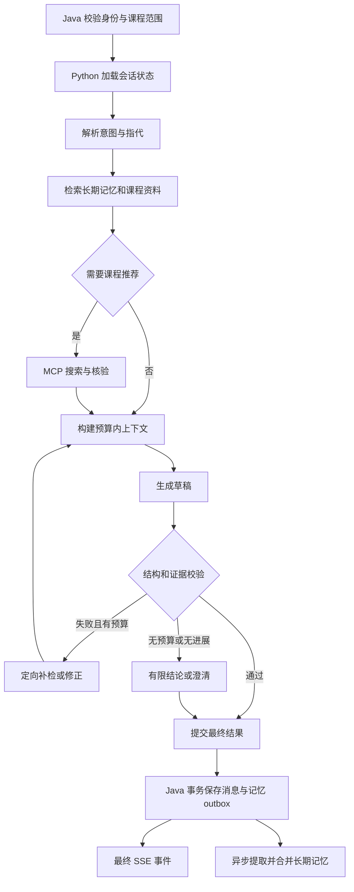

# 专精学习 Agent 开发方案与分块计划

> 版本：v1.2 · 日期：2026-10-16  
> 状态：开发设计，任务尚未执行；本文不代表功能已经实现或通过验收。  
> 目标：在现有课程工作台之上，新增由 Java API 调用的 Python 学习 Agent，完成资料问答、学习记忆和按需课程推荐。

## 1. 开发基线与范围

### 1.1 当前项目事实

| 目录/组件 | 当前能力 | 本次开发方式 |
|---|---|---|
| `client/` | Vue 3 课程工作台、资料上传、原视频分析界面 | 增加课程聊天、来源引用、记忆管理和推荐卡片 |
| `server/` | Java 21 / Spring Boot 3.5.9、登录、课程/章节/资料管理 | 保留业务入口，新增学习会话与 Python 调用适配 |
| Java 视频链路 | 转写、OCR、VideoContext、视频分块和 Qdrant 检索 | 复用解析产物，不为学习问答重复下载和转写 |
| Java AgentLoop | Planner / Executor / Critic、预算、检查点 | 保留旧行为，借鉴预算与证据验证设计 |
| `knowledge_service/` | Python 文档格式归一化，支持已有 Docling JSON 和 VideoContext | 扩展真实文件解析、分块、索引和检索模块 |
| 基础设施 | MySQL、Redis、MinIO、RocketMQ、Qdrant | 复用实例，独立表、集合、主题和键空间 |

当前 Python 入口是离线 CLI，尚无完整 HTTP 服务、统一资料向量入库、学习对话和长期记忆实现。课程工作台已有代码不等于真实环境验收完成，开发开始前应重新验证基线。

### 1.2 与现有文档的关系

- 课程入口和资料归属继续遵循 [课程工作台 v2](course-workbench-v2.md)，不恢复历史方案中独立资料产品入口。
- 本文是学习 Agent 的新增技术方案。该范围内采用 Python 服务，取代历史技术文档中的“不引入独立 Python Web 服务”假设。
- [历史学习计划](learning-plan/README.md)不直接作为本计划的执行台账，不将其 TODO 自动标记为完成。
- 不改写原视频 Agent 的模式、提示词、检查点格式、扩展接口或 `video_chunks` 集合。
- 本文任务编号使用 LA 前缀，与旧 T/W 编号区分。
- v1.1：新增知识链路全部由 Python 实现；Java 负责权限与业务状态投影。逐项编码任务见 [实施任务清单](learning-agent/IMPLEMENTATION-TASKS.md)。

### 1.3 交付范围

第一阶段：上传资料可检索、单课程有引用问答、会话延续、受控生成和运行追踪。

第二阶段：跨会话学习偏好与薄弱点记忆、用户查看/修改/删除记忆、记忆冲突处理。

第三阶段：通过 MCP 搜索课程、核验信息、按学习需求推荐、用户选择后加入课程。

暂不包含：多自主 Agent 协商、逐课程微调、完整知识图谱、自适应考试系统、自动购买/报名课程、全网视频批量下载。

## 2. 技术栈与选择理由

| 层 | 技术选择 | 理由与约束 |
|---|---|---|
| 前端 | 现有 Vue 3 / Vite / SSE | 复用课程页面与实时事件经验 |
| 业务 API | 现有 Java 21 / Spring Boot / MyBatis | 统一身份、课程权限、事务和业务数据 |
| Python API | FastAPI + Uvicorn + Pydantic | HTTP 接入、异步 I/O、明确的请求和输出 schema |
| Agent 编排 | LangGraph StateGraph | 显式节点、条件分支、受限循环；不用默认无限 ReAct 流程 |
| 模型适配 | 独立模型网关；按需使用 LangChain 模型适配器 | 模型调用不散落业务代码；支持替换供应商、记录 usage、统一超时 |
| 文档解析 | Docling + 现有 document_parser | 保留统一文档结构；视频沿用已有 VideoContext |
| 检索 | Python 操作 Qdrant 语义/关键词检索 + RRF | 向量、词法、融合和精排全部在 Python 中实现 |
| Python 数据访问 | SQLAlchemy + Alembic | 共用 media_db，Python 管理 ai_* 表与独立迁移历史，不修改 Java 表 |
| 精排 | 可配置 reranker | 先测基础检索；只有质量提升可验证时启用 |
| embedding | 先验证现有 BGE-M3 服务的复用 | 固定模型、维度、归一化规则及版本，避免隐式混用 |
| 数据与文件 | MySQL / Redis / MinIO | 业务真源、缓存、原文和解析产物各司其职 |
| 异步任务 | 现有 RocketMQ + MySQL outbox | 入库和记忆更新可重试，不依赖 Web 进程后台任务 |
| MCP | 官方 Python MCP SDK；平台 adapter | 协议与平台数据接入解耦，工具返回结构化结果 |
| 验证 | pytest、现有 Java/Javascript 测试、离线评估集 | 验证接口、状态、权限、引用与真实问答效果 |
| 部署 | 现有 Compose 增加 Python 服务/worker | 开发环境可复现；Web 与耗时解析分进程 |

Python 版本在 LA00 验证 Docling、LangGraph 和 MCP SDK 兼容性后锁定。现有归一化模块在 Python 3.13 验证过，不代表全部新增依赖均已兼容。Python 使用 `pyproject.toml` 与锁文件，Java/前端保留现有依赖管理方式；不在开发任务中顺便升级整个项目。

框架参考：[LangGraph 概览](https://docs.langchain.com/oss/python/langgraph/overview)、[持久化](https://docs.langchain.com/oss/python/langgraph/persistence)、[FastAPI](https://fastapi.tiangolo.com/)、[MCP Python SDK](https://github.com/modelcontextprotocol/python-sdk)、[Docling](https://docling-project.github.io/docling/)。具体依赖版本和供应商能力在 LA00 做兼容性验证，不把本文当作版本锁文件。

## 3. 服务边界与目录



### 3.1 职责分配

- Java：鉴权、课程/资源授权、会话消息、业务运行记录、学习记忆、outbox、对外 SSE；所有业务表的唯一写入方。
- Python：解析、分块、embedding、向量/词法索引构建与删除、索引发布、混合召回、重排、图编排、模型调用、结果校验、记忆候选提取和 MCP；拥有知识元数据、任务和检查点表。
- Python 从 Java 获取授权资源范围与原文件 sourceRevision，再从自己的数据库解析活动索引快照；向量和关键词检索均由 Python 执行。Java 不提供关键词候选、不写 chunk、不切换索引版本。
- Java 管理 sourceRevision；Python 管理绑定来源、解析器、分块器、embedding 版本的 indexRevision。原文件不变也可以重建索引。
- Java 不再对一次学习回答调用旧 AgentLoop；Python 也不重做 Java 登录或课程管理。
- 内部结果回调携带 `runId + attemptId`；Java 拒绝旧执行尝试覆盖已取消或已完成结果。

### 3.2 建议目录（均为待新增，已有模块除外）

```text
agent_service/
  api/                 # 请求、事件、取消接口
  graphs/              # 图状态、节点、路由、预算
  model_gateway/       # 模型、embedding、reranker 适配
  memory/              # 记忆提取与合并候选
  tools/               # MCP 客户端、工具注册和策略
  persistence/         # Python 执行记录、检查点适配
  schemas/             # 内部契约对应的 Pydantic 模型
  tests/
knowledge_service/
  modules/document_parser.py  # 已有，继续复用
  parsing/             # 真实文档转换与视频适配
  chunking/
  indexing/
  retrieval/
course_discovery_mcp/
  adapters/            # bilibili、mooc、站点搜索
  tools/
contracts/learning-agent/
  public-api.yaml
  internal-api.yaml
  schemas/
  examples/
evaluation/learning-agent/
  datasets/
  reports/
```

首版 Python Agent 与知识模块可以共用一个应用包和镜像，API 与 worker 用不同启动命令。课程发现 MCP 在第三阶段独立启动，不提前拆成大量微服务。

## 4. 两条核心工作流

### 4.1 异步资料入库

1. Java 上传并保存 MinIO 对象与资源记录；事务内写入任务和 outbox。
2. MQ 消费者向 Python 提交幂等任务。Python 将任务持久化后才返回接受；Java 此时可确认投递完成，业务任务仍为处理中。
3. Python worker 使用租约领取任务；重启后可重新领取过期租约。不得仅用 FastAPI BackgroundTasks 承担可靠执行。
4. 文档经 Docling 转换，再调用已有归一化模块；视频读取现有 VideoContext。
5. 按标题、段落、表格和视频片段边界切块；保留 locator 和原始元素关联。
6. Python 生成 embedding、写待发布版本的 Qdrant 点；chunk 原文、locator、来源和版本放 payload，关键词召回也在向量检索系统内实现。MinIO 保存可重建产物，MySQL 只保存任务及活动索引记录。
7. Python 核验数量、哈希、维度和来源版本后，在本地事务中用 CAS 切换 activeIndexRevision、标记 READY 并写知识 outbox。Qdrant 不属于该事务，只有完成写入与可见性验证的不可变索引版本才能发布。
8. Java 接收 Python 事件更新展示投影，按资源状态序号拒绝重复/乱序回调。查询只使用 Python 已发布版本；半份索引不可见。
9. 发布前复核 sourceRevision 和资源存活状态；迟到任务不可覆盖新索引。复核后发生撤权的竞态，由检索过滤和最终提交授权检查兜底。

建议状态：`UPLOADED → QUEUED → PARSING → CHUNKING → INDEXING → READY`，任意执行阶段可到 `FAILED`，取消到 `CANCELLED`。新状态须映射现有上传展示，不擅自改旧视频状态含义。

起始分块参数可用约 400–800 tokens、少量重叠，但以真实中文课件和表格评估调整；不得为了凑长度拆断表格或丢掉标题路径。

### 4.2 学习问答



用户偏好可先读取，用于理解需求；指代补全后，长期语义记忆检索和知识检索可并行。简单问答不强制调用规划模型或 Critic 模型。完整上下文指信息足够，不代表全量加载。

首版 SSE 推送阶段进度和经验证的完整答案。若后续支持 token 流，必须区分 `draft_delta` 与 `answer_committed`；草稿不作为已完成消息，也不进入长期事实记忆。

## 5. 知识、记忆与上下文设计

| 数据 | 范围 | 真源 | 更新规则 |
|---|---|---|---|
| 课程知识 | 资料事实与版本 | 原文/解析产物 + MySQL 元数据 | 资料变更触发重建；回答不自动写入知识库 |
| 短期记忆 | 当前会话消息、摘要、运行状态 | MySQL 消息和检查点 | 每轮提交；摘要记录覆盖到哪个消息序号 |
| 长期记忆 | 用户偏好、目标、学习事件、薄弱点 | MySQL 学习记忆 | 候选提取、证据验证、去重、冲突处理后更新 |

### 5.1 检索约束

- 复用 Qdrant 实例；新增版本化资料集合，旧 `video_chunks` 保持不变。用户记忆向量索引是可选扩展，逻辑上独立。
- 资料 payload 包括所有者、资源、sourceRevision、indexRevision、chunkId、embeddingVersion；Python 将 Java 授权范围与活动索引求交，向量与词法查询使用相同过滤范围。
- 同一资源可属于多课程，不能用一个可变 courseId 字段覆盖原有归属。首版以授权资源集合过滤；规模增长后再评估冗余课程索引。
- 向量与关键词召回融合后去重和重排，只将有限证据放入上下文。建议起点为各召回 20 条、融合后选 6–10 条，最终以 token 预算和评估结果为准。
- Python 生成 knowledgeSnapshotId，固定本次资源/indexRevision 映射；Java 提供 scopeVersion 标识权限范围。构建上下文前复核授权，Java 最终提交事务内检查 scopeVersion 与引用来源；变化则拒绝并有限重检。授权服务不可用时失败关闭，不回退为全库查询。
- 删除资料先在 Java 撤销可见性，再通过 outbox 请求 Python 标记 tombstone、清理索引。移出单个课程仅撤销关联，不能删除其他课程仍引用的资料索引。
- 旧索引在快照租约到期且无运行引用后清理；用户删除时权限立即失效。旧入库事件不得越过 tombstone 恢复资源。

### 5.2 记忆更新

长期记忆建议字段：`id, userId, courseId?, type, key, value, sourceMessageIds, evidenceLevel, confidence, version, createdAt, updatedAt, expiresAt?, deletedAt?`。

- 类型区分偏好、目标、用户自述、观测学习事件、推断薄弱点。
- 用户明确表达的偏好可直接产生候选；模型推断标记为推断，不能伪装成用户事实。
- 一次错误只保存学习事件；形成长期薄弱点需要明确规则和足够证据。
- 新候选带来源；Java 使用版本检查处理合并，旧任务不能覆盖用户刚修改的记忆。
- 删除记忆后阻止旧 outbox 任务将其复活；必要时使用删除版本或抑制标记。
- 用户可查看、修改、删除记忆；默认不把完整外部搜索结果或模型内部推理存为记忆。
- 记忆异步尚未完成时，下一轮仍可读取已提交会话消息。

### 5.3 上下文构造

顺序建议：系统行为约束 → 当前问题和课程范围 → 近期会话/摘要 → 相关学习记忆 → 带编号资料证据 → 已核验课程候选 → 输出要求。

先为输出预留 token，再分配输入预算。超限时先去掉低相关证据和过旧消息，不截断系统约束或来源字段。外部网页与文档内容均视作数据，不能覆盖系统指令或开启额外工具。

## 6. API、状态与存储契约

### 6.1 对外接口草案（Java）

现有 `/learn/courses` 等接口保留，新增路径在 LA01 冻结：

| 接口 | 用途 |
|---|---|
| `POST /learn/courses/{courseId}/conversations` | 创建会话 |
| `GET /learn/conversations/{id}/messages` | 分页读取消息 |
| `POST /learn/conversations/{id}/runs` | 提交问题，返回 202 和 runId |
| `GET /learn/runs/{id}` | 查询状态和已提交结果 |
| `GET /learn/runs/{id}/events` | SSE；支持断线续传 |
| `POST /learn/runs/{id}/cancel` | 请求取消 |
| `GET /learn/memories` | 查看本人的学习记忆 |
| `PATCH /learn/memories/{id}` | 按版本修改 |
| `DELETE /learn/memories/{id}` | 删除并使索引失效 |

业务响应沿用现有项目封装；新 ID 对外采用字符串，时间使用 UTC ISO 8601。Java 按登录态确定用户，拒绝请求体身份替换。新增 PATCH/CORS 与权限拦截必须做验证。

### 6.2 Java → Python

- `POST /internal/agent/runs`：创建执行，传 `runId, attemptId, conversationId, userId, courseId, question, authorizedScope, scopeVersion, budget, traceId`。
- `GET /internal/agent/runs/{runId}`：执行状态与结果。
- `GET /internal/agent/runs/{runId}/events`：内部进度事件。
- `POST /internal/agent/runs/{runId}/cancel`：取消当前 attempt。
- `POST /internal/knowledge/jobs`：提交解析/索引任务；独立查询和取消接口在 LA01 定义。
- POST /internal/knowledge/search：Python 混合检索，返回证据和 knowledgeSnapshotId；Java 不参与召回实现。
- GET /internal/knowledge/jobs/{jobId}、POST /internal/knowledge/jobs/{jobId}/cancel：查询和取消。
- POST /internal/knowledge/resources/{resourceId}/invalidate：携带来源版本、业务序号和失效原因，幂等处理。
- Python → Java：内部授权、会话/记忆读取、结果提交、记忆候选提交、知识状态回调；没有关键词候选接口。

内部接口使用服务认证；授权范围带有效期并在关键阶段复核。MinIO 访问用受限凭证或短期签名地址，不接受任意本地路径。平台工具限定允许访问的主机，防止外部 URL 被用来访问内网。

### 6.3 幂等与并发

- 新建 run 使用 `Idempotency-Key`；同键同请求返回原 run，不同请求返回冲突。
- 同一 conversation 首版仅允许一个活动 run，新请求返回明确的运行中冲突；不同会话可并发。
- 状态：`QUEUED / RUNNING / COMPLETED / NEEDS_INPUT / FAILED / CANCELLED`。
- `stopReason` 区分完成、需要澄清、预算耗尽、无新增证据、工具不可用、取消。
- SSE 包含 `runId, attemptId, sequence, eventId, type, timestamp, payload`，按序号去重。事件超过保留窗口时返回快照并要求重新同步。
- Java 保存业务状态；Python 保存执行状态。通过 attempt fencing、幂等回调和定期对账修复差异，不能假定跨服务存在单一数据库事务。
- 取消后 worker 在节点边界与工具调用前检查；已发出的模型调用尽力取消，其迟到结果不得发布。

### 6.4 最终输出

```json
{
  "schemaVersion": "1",
  "status": "completed",
  "answer": "回答正文",
  "citations": [{"resourceId": "r1", "revision": "v1", "chunkId": "c1", "locator": {"type": "page", "pageIndex": 0}}],
  "recommendedCourses": [],
  "limitations": [],
  "nextAction": null,
  "stopReason": "completed"
}
```

页面索引沿用归一化模块的零基约定，UI 展示时加一；视频 locator 使用毫秒范围；Word 使用元素定位。引用允许多个 locator，不凭空生成页码或视频时间。

### 6.5 待新增数据领域

| 数据领域 | 唯一写入服务 | 存储与角色 |
|---|---|---|
| 课程、资料归属、权限、sourceRevision | Java | 现有 MySQL，业务真源 |
| 会话、消息、业务运行、记忆、学习事件、业务 outbox | Java | 现有 MySQL；记忆候选由 Python 提取 |
| 处理状态展示 | Java | Python 事件的业务投影 |
| chunk 原文、locator、关键词检索数据、版本 metadata | Python | Qdrant；MinIO 留存可重建产物 |
| 活动索引记录、tombstone | Python | media_db 的 ai_* 表 |
| 执行任务、租约、检查点、快照、执行事件、知识 outbox | Python | media_db 的 ai_* 表，执行真源 |
| 向量索引 | Python | Qdrant 新集合，可重建 |
| 原文件 | Java | MinIO 原文件前缀 |
| 解析 JSON/Markdown、分块产物 | Python | MinIO 独立版本化产物前缀 |

复用现有课程和资源表，不新建平行课程体系。Qdrant、MinIO 是存储设施，不是服务所有者。Java 使用 Flyway；Python 使用 SQLAlchemy + Alembic 管理同一 media_db 中的 ai_* 表（含 ai_alembic_version），两套迁移不能管理同表。运行账号按表最小授权，DDL 由部署迁移账号执行；跨服务通过 API 访问业务数据。

知识发布状态以 Python 为真源，Java READY 只是展示投影。Python 发布事务写知识 outbox，Java 按序号幂等接收；回调失败退避重试并通过查询对账修复。业务权限和原文件版本以 Java 为真源，状态投影滞后不能放宽检索授权。

## 7. 有限循环、可靠性和质量控制

### 7.1 首轮预算建议

| 项目 | 初始策略 |
|---|---|
| 普通问答修正 | 最多 1 次 |
| 找课查询改写 | 最多 2 次 |
| MCP 工具调用 | 每次 run 最多 6 次 |
| 总时长 | 普通问答先以 60 秒、找课 120 秒评估 |
| token / 费用 | 显式配置输入、输出、总预算；实际 usage 入账，调用前估算预留 |
| 无进展停止 | 同查询同参数不重复调用；补检无新增有效证据则结束 |

以上是待评测起点，不是性能承诺。节点重试、模型修复和框架内部重试都计入同一预算；禁止层层自动重试相乘。图步数限制只作最后保险，不替代 deadline 和调用次数限制。

### 7.2 输出校验

1. Pydantic 校验结构和字段长度。
2. 代码检查引用存在、属于本次授权证据、版本有效、locator 合法。
3. 引用存在不代表语义支持；对关键结论检查证据支持程度，结合评估集和必要的模型审查。
4. 课程 URL、标题和价格必须来自工具结果；缺失信息明确标未知。
5. 资料不足时回答有限结论或提出具体澄清，不通过循环强凑答案。

### 7.3 检查点路线

- MVP 持久化业务消息、run 和任务；失败可以整次重试，副作用依靠幂等保护。
- 上线恢复能力前，完成符合 LangGraph 接口的 MySQL 持久化适配并测试 pending writes、序列化、并发和恢复语义；不能把 JSON 快照等同于完整 checkpointer。
- LA00 评估维护适配器成本；若过高，记录架构决策再选择已维护的持久化后端，不能静默新增数据库。
- 旧 Java checkpoint 保持原用途；生产不使用内存 saver 宣称断点恢复。

## 8. MCP 课程推荐设计

### 8.1 接入事实与工具

MCP 是工具协议，不提供平台访问权限。Bilibili 开放平台展示的稿件管理能力不等于全站课程搜索；中国大学 MOOC 已检索到的课程接口涉及学校云赋权范围。实施时必须核实账号权限、接口覆盖和实际返回。

参考：[Bilibili 开放平台](https://openhome.bilibili.com/doc)、[MOOC 接口文档](https://docs.icourse163.org/api-doc/get-info.html)。本计划不假设官方已经存在可直接接入的全站搜索 MCP。

首版工具：`search_courses`、`get_course_details`、`get_course_outline`。`get_transcript` 仅在确实具备授权和数据能力时开放。

每个平台适配器公开能力标记：能否搜索、取目录、取字幕、是否需要授权。工具结果包含稳定平台 ID、规范 URL、来源、抓取时间、已知字段、未知字段和错误类型。

### 8.2 推荐链路

需求提取 → 候选召回 → 详情核验 → 去重 → 硬条件过滤 → 相关性/难度/时长排序 → 展示 3–5 个有解释的候选。

用户的知识点、当前水平、时间和语言是主要信号；播放量不能代表教学质量。只有标题和简介时标记“初步匹配”，不能宣称已审阅完整课程内容。

无正式搜索接口时可接站点限定搜索服务，核验公开课程页并记录覆盖不足；访问受限时明确降级，不绕过登录和付费限制。网页提取内容视为不可信输入，不能触发额外写操作。

默认只搜索和推荐链接。用户点击加入后，Java 再次校验课程与资源；视频平台若无法合法稳定获取内容，可保存外部学习链接，不伪装成已入库可检索资料。

## 9. 分块开发计划

所有任务初始状态为 TODO。每包只完成自己的交付物和必要接入，结束时提供变更文件、验证结果、未决问题与下一包入口。

| 编号 | 模块与开发思路 | 前置 | 交付物与验收重点 |
|---|---|---|---|
| LA00 | 基线与兼容性验证：启动现有核心链路，验证 Python 依赖和模型结构化输出/工具能力 | 无 | 基线报告、依赖锁、模型能力矩阵、checkpoint 选型记录；明确真实文件转换是否可用 |
| LA01 | 契约先行：冻结身份、任务、事件、引用和输出 schema | LA00 | OpenAPI、JSON Schema、正反例、数据所有权、错误码；Java/Python 对同一样例判定一致 |
| LA02 | Python 服务骨架：FastAPI、配置、健康检查、日志、服务认证、模型网关接口 | LA01 | 可启动服务及 Java 客户端；使用 fake 模型完成请求往返，未配置新功能不影响旧后端 |
| LA03 | 可靠任务底座：Java outbox、Python 持久化任务/租约、幂等和取消 | LA02 | MQ 重复投递、网络超时、worker 重启、迟到回调均不重复提交业务结果 |
| LA04 | 真实资料解析：Docling converter 与视频结果适配 | LA03 | PDF/DOCX/PPTX 和已有视频上下文样本产物；定位、阅读顺序、质量标记验证；旧 DOC/PPT 明确拒绝或单独转换 |
| LA05 | 结构化分块：标题路径、表格和视频时间边界 | LA04 | 稳定 chunkId、locator、版本、分块产物；跨页/长表格/空文本样本通过 |
| LA06 | Python 索引构建与发布：embedding、Qdrant 语义/关键词索引、activeIndexRevision、状态回调 | LA05 | 上传到 READY 闭环；半失败索引不可见；重试不产生重复活动版本 |
| LA07 | 混合检索与证据接口：权限过滤、融合、裁剪、来源映射 | LA06 | 检索评估报告；跨用户/跨课程隔离、删除失效、版本一致性通过 |
| LA08 | 学习会话与短期记忆：消息持久化、摘要边界、单会话并发控制 | LA02、LA03 | 会话 API 与历史；重复提交、会话切换、断线、摘要覆盖范围可验证 |
| LA09 | 单轮学习图：意图解析→记忆/知识→上下文→回答→校验→提交 | LA07、LA08 | 有引用的课程问答；无资料、指代追问、超长输入有明确行为 |
| LA10 | 预算、有限修正与恢复：共享 deadline、无进展停止、持久化适配 | LA09 | 超时/取消/进程重启/重复工具调用测试；恢复能力有真实证据，未实现项不宣称支持 |
| LA11 | 学习聊天 UI：接入现有课程页、SSE、引用跳转、错误与取消 | LA09 | 页面到真实后端闭环；刷新后恢复历史；草稿与最终结果不混淆 |
| LA12 | 长期记忆：候选提取、Java 合并、版本冲突、修改删除 UI | LA10、LA11 | 跨会话偏好生效；推断与事实区分；删除后不被迟到任务恢复 |
| LA13 | 课程发现 MCP：SDK、能力表、平台适配与缓存 | LA02、LA03 | 至少一个真实可用来源；mock 不能算真实平台验收；无权限/超时明确返回 |
| LA14 | 个性化课程推荐：需求生成查询、核验排序、推荐卡与加入入口 | LA12、LA13 | 候选理由可追溯；未知信息不编造；无法获取视频时保存链接或明确失败 |
| LA15 | 综合评估与发布：真实样本、负载、故障、兼容性与回滚 | LA10、LA11、LA12、LA14 | 评估报告、部署说明、开关和回滚演练；全部门槛满足后标记可发布 |

### 9.1 里程碑

- G0，开发基础就绪：LA00–LA03；服务可互通，任务不因重启丢失。
- G1，资料知识库就绪：LA04–LA07；真实上传资料可检索且有来源。
- G2，问答 MVP：LA08–LA11；单课程多轮对话、引用、预算和取消可用。
- G3，学习记忆：LA12；跨会话记忆可解释、可修改、可删除。
- G4，课程推荐：LA13–LA14；真实数据来源可用且推荐可追溯。
- G5，发布：LA15；完成性能、故障、权限和旧功能回归。

优先按里程碑交付。MCP 不应阻塞资料问答 MVP；长期记忆未完成时，短期会话仍应完整可用。

### 9.2 每个任务包的完成标准

1. 实现与已冻结契约一致，新增字段同步更新样例。
2. 有正常路径和与该功能相关的失败路径验证；不使用只复述实现的测试代替验收。
3. 标记验证类型：单元、模拟集成、真实服务、真实模型或浏览器端到端。
4. 不把 mock 成功视为平台、模型或解析器真实接入成功。
5. 提交交接记录：目标、修改文件、配置/迁移、执行命令、结果、限制、下一步。
6. 更新本计划对应任务状态时附证据，不仅写“已完成”。

逐项实施遵循 [小需求任务清单](learning-agent/IMPLEMENTATION-TASKS.md)。每次执行一个子任务，不直接把整个 LA 大包当作一次编码任务；完成后记录对应任务证据。本次只修改计划，不标记代码任务完成。

## 10. 验证与发布门槛

### 10.1 评估集

建立不少于 50 个初始问题，覆盖定义、比较、公式、表格、跨资料综合、视频定位、指代追问、资料无答案和错误前提。每项记录授权资料、预期证据、评分标准；调试集和保留评估集分开。

另建记忆样本：明确偏好、偏好变化、一次答错、多次观测、跨课程差异、用户删除；推荐样本覆盖初学/进阶、时间限制、免费条件、失效链接和平台不可用。

### 10.2 初始验收目标

以下是工程起点，在 LA00/LA07 用样本确认，不能通过删难题来达标：

| 指标 | 目标 |
|---|---|
| 权限与版本测试 | 所有越权、删除失效、旧版本不可见用例通过 |
| 结构与引用合法性 | 发布结果 schema 合法；所有引用可定位且有权访问 |
| 检索 Recall@10 | 对有标注证据的问题，初始目标 ≥ 85% |
| 回答证据支持率 | 抽查原子事实主张，初始目标 ≥ 90%；说明抽样与评分方式 |
| 重复投递 | 不重复发布最终消息、不重复合并同一记忆事件 |
| 预算终止 | 所有终止路径能输出明确状态，不继续发起新调用 |
| 性能 | 记录固定模型/语料/并发下 p50、p95、调用数和 token，达成约定预算后再承诺 SLA |
| 旧功能 | 既有视频 API、工作台和浏览器扩展相关回归通过 |

模型自评只作辅助。语义支持和推荐适合度需要人工标注样本或人工复核，不能仅看 JSON 合法率。

### 10.3 部署与回滚

- 新学习 Agent 和课程推荐使用独立功能开关；关闭后旧项目可启动和工作。
- 解析、索引、模型、MCP 分别设置并发上限；不要占满 Java Web 线程或 Python 事件循环。
- 日志按 traceId / runId / jobId 串联，记录阶段耗时、重试、token、检索命中和停止原因；默认不输出凭证或完整私人资料。
- 数据库迁移先增量发布，再启用服务；保留旧索引版本，失败时由 Python 校验来源仍有效后切回旧 activeIndexRevision，不恢复已删除资料。
- 回滚先关新入口、停止新任务，再处理存量 run；不通过删库或清空旧向量集合回滚。
- 对账任务处理长时间 RUNNING、过期租约、未投递 outbox、孤立索引和记忆索引延迟。

## 11. 首个开发任务的具体入口

从 LA00 开始：验证现有课程创建与上传、Python 归一化测试和视频结果读取；选取一份真实 PDF、一份 PPTX、一份 DOCX 与一份已有 VideoContext；验证新增依赖、模型结构化输出及可用 embedding；形成依赖锁与能力报告。

之后完成 LA01 的接口与数据所有权，再写业务功能。第一个可交付切片应是“上传一份资料 → 索引 READY → 问一个问题 → 返回可打开的引用”，随后扩展会话、长期记忆和 MCP 推荐。

## 12. 当前实现与验收

分块前阶段的实际交付、部署方式和未验证项见 [解析服务运行说明](learning-agent/PARSING-RUNBOOK.md) 与 [状态台账](learning-agent/STATUS.json)。本轮不实现 LA05 分块以及后续索引。关键词与语义检索统一放 Qdrant；不再建 MySQL 全文 chunk 表。
